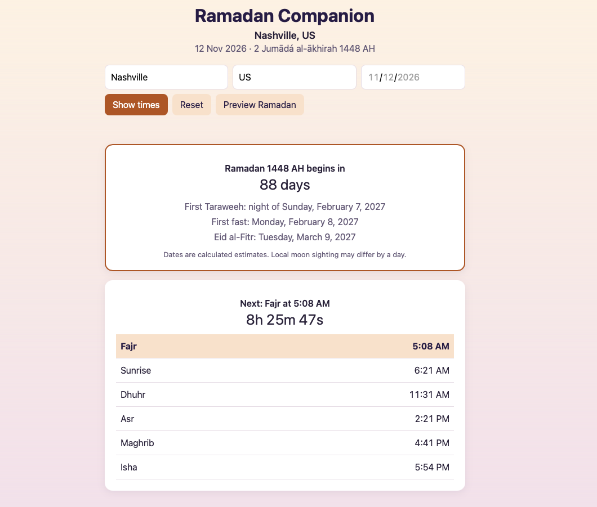
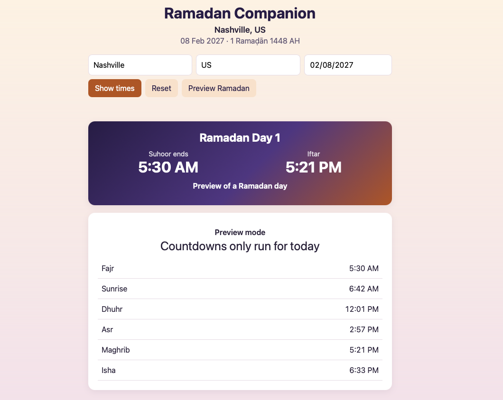

# 🌙 Ramadan Companion

A full-stack web app that shows accurate prayer times for any city and **automatically switches into Ramadan mode** when the month begins, with Suhoor and Iftar times, live countdowns, and the day of Ramadan.

Built with **Java 21 + Spring Boot** on the backend and plain **HTML, CSS and JavaScript** on the frontend.

| Everyday mode | Ramadan mode |
|---|---|
|  |  |

##  Features

- **Prayer times for any city** — live data, shown in 12-hour time
- **Next prayer highlighted** with a live countdown, rolling over to tomorrow's Fajr after Isha
- **Automatic Ramadan mode** — detected from the Islamic (Hijri) calendar, no hard-coded dates
    - Suhoor and Iftar shown prominently, with a countdown to whichever comes next
    - "Ramadan Day X" and a countdown to Eid al-Fitr
- **Countdown to the next Ramadan** with the expected first Taraweeh, first fast and Eid
- **Preview any date** to see what a Ramadan day will look like
- Hijri and Gregorian dates side by side

##  How it works

```
Browser (HTML/CSS/JS)
      │  fetch("/api/prayer-times"), fetch("/api/ramadan")
      ▼
Spring Boot REST API  ──►  AlAdhan API (prayer times + calendar conversion)
  Controller → Service
```

- **Controllers** handle the web requests and validate input (dates must be real ISO dates, e.g. `2027-02-08`).
- **Services** call the external AlAdhan API, convert its response into the app's own clean data model, and contain the Ramadan logic.
- The **frontend** decides which mode to show based on the `ramadan` flag returned by the backend.

### Ramadan logic

1. Convert today's date to the Hijri calendar.
2. If this year's Ramadan (month 9) has already passed, look at next year's.
3. Convert *1 Ramadan* and *1 Shawwal (Eid)* back to Gregorian dates.
4. Work out whether Ramadan is in progress, which day it is, or how many days remain.

##  API

| Endpoint | Description |
|---|---|
| `GET /api/prayer-times?city=Nashville&country=US` | Today's prayer times, plus `ramadan` and `ramadanDay` |
| `GET /api/prayer-times?city=London&country=UK&date=2027-02-08` | Prayer times for a specific date |
| `GET /api/ramadan` | Next (or current) Ramadan: start, end, Eid, days until it begins |

## 🛠️ Tech stack

- **Backend:** Java 21, Spring Boot, Spring Web (REST), RestClient, Jackson, Maven
- **Frontend:** HTML, CSS (custom properties for theming), JavaScript (fetch, async/await)
- **Data:** [AlAdhan API](https://aladhan.com/prayer-times-api) — ISNA calculation method

##  Run it locally

Requires Java 21.

```bash
git clone https://github.com/Yahyefarah/ramadan-companion.git
cd ramadan-companion
./mvnw spring-boot:run
```

Then open **http://localhost:8080**.

##  What I learned

- **Debugging a `NullPointerException` caused by an HTTP redirect** — the browser followed AlAdhan's redirect automatically, but Java's HTTP client didn't, so the response body was empty.
- **Date formats matter** — I switched the API from `DD-MM-YYYY` to the ISO standard `YYYY-MM-DD` after confusing *1 March* with *3 January* myself. Spring now rejects impossible dates like February 30 automatically.
- **Time-zone bugs in JavaScript** — `new Date("2027-02-08")` is read as UTC midnight, which is still February 7 in Nashville, so dates are built from their parts instead.
- **Dependency injection** — a single shared `RestClient` is configured once and injected into both services.

##  Background

This started as my database course project: a small website where I typed Ramadan prayer and fasting times for 2022–2025 into a SQLite database by hand from PDF timetables. Ramadan Companion is the rebuilt version — live data for any city and any year, and an interface that adapts to the time of year.

##  Roadmap

- [ ] Automated tests (JUnit) and CI with GitHub Actions
- [ ] Deploy online
- [ ] Remember the last city and "use my location"
- [ ] Full 30-day Ramadan timetable and the last ten nights
- [ ] Fasting tracker with a database

##  Author

**Yahye Farah** — Computer Science student, graduating May 2027
[GitHub](https://github.com/Yahyefarah)